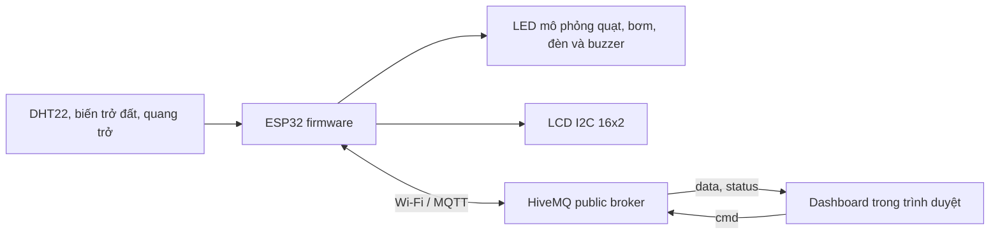

# Greenhouse IoT - Điều khiển và giám sát nhà kính

> Dự án mô phỏng hệ thống nhà kính dùng ESP32. Firmware đọc cảm biến nhiệt độ, độ ẩm không khí, độ ẩm đất và ánh sáng; điều khiển quạt, bơm, đèn theo chế độ tự động hoặc lệnh tay; hiển thị trạng thái trên LCD và gửi dữ liệu qua MQTT tới dashboard trên trình duyệt.

> **Phạm vi hiện tại:** Sơ đồ Wokwi dùng LED để minh họa quạt, bơm và đèn; biến trở làm giá trị giả lập cảm biến độ ẩm đất. Đây là mô hình học tập, chưa phải mạch điều khiển thiết bị công suất ngoài đời.

## Mục lục

- [1. Chức năng](#1-chức-năng)
- [2. Kiến trúc hoạt động](#2-kiến-trúc-hoạt-động)
- [3. Cấu trúc dự án](#3-cấu-trúc-dự-án)
- [4. Phần cứng và đấu nối](#4-phần-cứng-và-đấu-nối)
- [5. Logic điều khiển](#5-logic-điều-khiển)
- [6. Công cụ và thư viện](#6-công-cụ-và-thư-viện)
- [7. Cài đặt và biên dịch](#7-cài-đặt-và-biên-dịch)
- [8. Chạy mô phỏng Wokwi](#8-chạy-mô-phỏng-wokwi)
- [9. Sử dụng dashboard](#9-sử-dụng-dashboard)
- [10. Giao thức MQTT](#10-giao-thức-mqtt)
- [11. Nạp lên ESP32 thật](#11-nạp-lên-esp32-thật)
- [12. Kiểm tra và hiệu chỉnh](#12-kiểm-tra-và-hiệu-chỉnh)
- [13. Khắc phục sự cố](#13-khắc-phục-sự-cố)
- [14. Giới hạn và an toàn](#14-giới-hạn-và-an-toàn)

## 1. Chức năng

- Đọc DHT22 để lấy nhiệt độ và độ ẩm không khí.
- Đọc đầu vào analog của biến trở mô phỏng độ ẩm đất và cảm biến quang trở.
- Tính phần trăm quy ước cho đất và ánh sáng từ giá trị ADC 12-bit.
- Điều khiển quạt, bơm, đèn tự động theo ngưỡng có hysteresis hoặc bằng lệnh thủ công.
- Bật buzzer khi nhiệt độ cao hơn 37 °C.
- Hiển thị nhiệt độ, độ ẩm không khí, độ ẩm đất, ánh sáng và chế độ lên LCD I2C 16x2.
- Gửi số liệu định kỳ qua MQTT; nhận lệnh từ dashboard hoặc MQTT client khác.
- Dashboard theo dõi số liệu trực tiếp, vẽ tối đa 30 mẫu gần nhất, hiển thị kết nối và điều khiển thiết bị.

Độ ẩm không khí hiện chỉ được giám sát, **không tham gia logic tự động bật/tắt thiết bị**.

## 2. Kiến trúc hoạt động



Firmware đọc cảm biến mỗi 2 giây. Khi MQTT đã kết nối và DHT22 đọc hợp lệ, firmware phát JSON lên topic dữ liệu. Dashboard đăng ký nhận topic dữ liệu và trạng thái, rồi gửi lệnh điều khiển lên topic lệnh. Firmware kiểm tra lệnh, cập nhật ngõ ra và tiếp tục phát trạng thái trong bản tin dữ liệu kế tiếp.

## 3. Cấu trúc dự án

| Đường dẫn | Mục đích |
| --- | --- |
| `src/main.cpp` | Firmware ESP32: Wi-Fi, MQTT, cảm biến, LCD và logic điều khiển. |
| `platformio.ini` | Board, framework, baud rate và thư viện firmware cần cài. |
| `diagram.json` | Linh kiện và dây nối của mạch Wokwi. |
| `wokwi.toml` | Đường dẫn firmware ELF/BIN để Wokwi nạp chương trình mô phỏng. |
| `dashboard.html` | Giao diện giám sát và điều khiển MQTT, chạy trực tiếp trên trình duyệt. |
| `.vscode/extensions.json` | Khuyến nghị cài PlatformIO IDE cho VS Code. |
| `.vscode/settings.json` | Thiết lập của workspace VS Code. |
| `include/` | Thư mục dành cho header riêng; hiện chưa có file dự án. |
| `lib/` | Thư mục dành cho thư viện riêng; hiện chưa có thư viện dự án. |
| `.pio/`, `build/` | Thư mục đầu ra/tạm thời; không phải mã nguồn cần sửa khi phát triển. |

## 4. Phần cứng và đấu nối

### Linh kiện trong mô phỏng

- ESP32 DevKit V1.
- Cảm biến nhiệt độ/độ ẩm DHT22.
- LCD1602 giao tiếp I2C, địa chỉ firmware đang cấu hình là `0x27`.
- Biến trở nối analog, dùng giả lập cảm biến độ ẩm đất.
- Cảm biến quang trở, lấy ngõ ra analog AO.
- Ba LED xanh dương, xanh lá, vàng cùng điện trở 220 Ω để biểu diễn quạt, bơm, đèn.
- Buzzer.

### Bảng chân

| Thiết bị / tín hiệu | Chân ESP32 | Ghi chú |
| --- | --- | --- |
| DHT22 DATA | GPIO 15 | VCC nối 3V3, GND nối GND. |
| Đầu dò đất giả lập SIG | GPIO 34 | ADC input-only; VCC 3V3, GND chung. |
| Quang trở AO | GPIO 35 | ADC input-only; VCC 3V3, GND chung. |
| LCD SDA | GPIO 21 | I2C SDA mặc định trên board này. |
| LCD SCL | GPIO 22 | I2C SCL mặc định trên board này. |
| LED quạt | GPIO 26 | Đi qua điện trở 220 Ω; firmware bật mức HIGH. |
| LED bơm | GPIO 27 | Đi qua điện trở 220 Ω; firmware bật mức HIGH. |
| LED đèn | GPIO 25 | Đi qua điện trở 220 Ω; firmware bật mức HIGH. |
| Buzzer | GPIO 14 | Firmware bật khi nhiệt độ vượt ngưỡng báo động. |

Trong `diagram.json`, LCD được cấp VCC từ chân VIN của board mô phỏng; các cảm biến analog được cấp 3V3. Tất cả thiết bị phải có GND chung. Khi lắp mạch thật, kiểm tra điện áp hoạt động và sơ đồ chân của đúng module đang dùng; không cấp tín hiệu cao hơn mức cho phép của ESP32.

## 5. Logic điều khiển

Mặc định ESP32 khởi động ở chế độ **AUTO**, các ngõ ra khởi đầu tắt. Firmware dùng hysteresis để hạn chế bật/tắt liên tục khi giá trị dao động quanh ngưỡng:

| Thiết bị | Điều kiện bật | Điều kiện tắt | Vùng giữ trạng thái |
| --- | --- | --- | --- |
| Quạt | Nhiệt độ `> 32 °C` | Nhiệt độ `< 30 °C` | Từ 30 đến 32 °C, giữ trạng thái trước đó. |
| Bơm | Độ ẩm đất `< 35%` | Độ ẩm đất `> 45%` | Từ 35 đến 45%, giữ trạng thái trước đó. |
| Đèn | Ánh sáng `< 30%` | Ánh sáng `> 40%` | Từ 30 đến 40%, giữ trạng thái trước đó. |
| Buzzer | Nhiệt độ `> 37 °C` | Nhiệt độ `<= 37 °C` ở lần đọc hợp lệ kế tiếp | Không có hysteresis. |

So sánh ngưỡng là nghiêm ngặt: đúng bằng ngưỡng bật/tắt không kích hoạt nhánh đó nên thiết bị giữ trạng thái. AUTO điều khiển quạt theo nhiệt độ, bơm theo đất và đèn theo ánh sáng. Độ ẩm không khí không có ngưỡng điều khiển trong phiên bản này.

Các tỷ lệ analog hiện là phép ánh xạ tuyến tính đơn giản:

- Đất: ADC 0 tương ứng 100%, ADC 4095 tương ứng 0% (`map(..., 0, 4095, 100, 0)`).
- Ánh sáng: ADC 0 tương ứng 0%, ADC 4095 tương ứng 100% (`map(..., 0, 4095, 0, 100)`).

Đây là thang hiển thị quy ước, chưa được hiệu chuẩn theo cảm biến đất hoặc đơn vị lux thực tế. Hướng tăng/giảm của cảm biến analog thật có thể khác mô phỏng.

Ở chế độ MANUAL, firmware không tự thay đổi quạt/bơm/đèn theo cảm biến. Lệnh điều khiển từng thiết bị cũng tự chuyển firmware sang MANUAL. Gửi `AUTO` để quay lại điều khiển tự động; các ngõ ra được cập nhật theo cảm biến ở chu kỳ đọc kế tiếp.

LCD hiển thị dòng 1 dạng `T:<nhiệt độ>C H:<độ ẩm>% A/M`; dòng 2 dạng `S:<đất>% L:<sáng>%`. `A` là Auto, `M` là Manual. Serial Monitor chạy ở 115200 baud và in trạng thái kết nối, lệnh nhận được, lỗi DHT hoặc JSON dữ liệu.

## 6. Công cụ và thư viện

### Công cụ phát triển

- **Visual Studio Code**: mở thư mục gốc của dự án.
- **PlatformIO IDE for VS Code** (`platformio.platformio-ide`): cài toolchain ESP32, thư viện, build, upload và mở Serial Monitor. Đây là extension được dự án khuyến nghị.
- **Wokwi Simulator for VS Code** hoặc Wokwi tương thích: chạy sơ đồ `diagram.json`; `wokwi.toml` trỏ tới đầu ra PlatformIO.
- **Trình duyệt hiện đại**: chạy `dashboard.html`. Dashboard cần Internet để tải MQTT.js, Chart.js, Lucide và font từ CDN; cần mở kết nối WebSocket TLS tới broker.
- **MQTT Explorer / Mosquitto clients** (tùy chọn): kiểm tra topic hoặc gửi lệnh mà không dùng dashboard.

### Thư viện firmware

PlatformIO cài các gói được khai báo trong `platformio.ini`:

- `adafruit/DHT sensor library` và `adafruit/Adafruit Unified Sensor` cho DHT22.
- `marcoschwartz/LiquidCrystal_I2C` cho LCD.
- `knolleary/PubSubClient` cho MQTT.
- `Arduino`, `WiFi` và API ESP32 được cung cấp bởi Arduino framework cho ESP32.

Dashboard không cần `npm install`; các thư viện giao diện được tải từ CDN khi mở trang. Nếu môi trường không cho tải CDN, dashboard sẽ không khởi tạo đầy đủ.

## 7. Cài đặt và biên dịch

### Cách dùng trong VS Code

1. Cài PlatformIO IDE từ VS Code Extensions nếu chưa có.
2. Mở **thư mục gốc** `greenhouse-iot`, không chỉ mở riêng `src/`.
3. Chờ PlatformIO tải platform ESP32 và các thư viện trong `platformio.ini` ở lần build đầu tiên.
4. Chạy lệnh **PlatformIO: Build** từ Command Palette hoặc mở PlatformIO Project Tasks, chọn môi trường `esp32dev` và chạy Build.
5. Sau khi build thành công, các file Wokwi cần dùng được tạo tại `.pio/build/esp32dev/firmware.bin` và `.pio/build/esp32dev/firmware.elf`.

### Cách dùng PowerShell

Nếu PlatformIO Core đã có trong `PATH`:

```powershell
pio run
```

Nếu PowerShell báo `pio` không được nhận diện nhưng PlatformIO IDE đã cài, gọi executable trong môi trường PlatformIO của Windows:

```powershell
$platformio = Join-Path $env:USERPROFILE ".platformio\penv\Scripts\platformio.exe"
& $platformio run
```

Các lệnh thường dùng:

```powershell
# Build firmware cho esp32dev
pio run

# Xóa đầu ra build rồi build lại
pio run -t clean

# Nạp firmware lên ESP32 thật qua cổng USB đã chọn
pio run -t upload

# Mở Serial Monitor ở 115200 baud
pio device monitor -b 115200
```

Thay `pio` bằng `& $platformio` trước các tham số tương ứng nếu lệnh `pio` không có trong `PATH`. Lệnh upload cần driver USB-UART phù hợp và cổng serial khả dụng; đóng Serial Monitor trước khi upload nếu cổng đang bị chiếm.

Môi trường build hiện tại là `[env:esp32dev]`, board `esp32dev`, framework `arduino`, baud Serial Monitor `115200`.

## 8. Chạy mô phỏng Wokwi

1. Build firmware ít nhất một lần bằng PlatformIO.
2. Mở `diagram.json` trong VS Code có Wokwi Simulator extension, rồi khởi động mô phỏng theo hướng dẫn của extension. Có thể mở/import sơ đồ JSON trên Wokwi nếu đang dùng Wokwi trên web.
3. Wokwi đọc binary và ELF từ các đường dẫn đã cấu hình trong `wokwi.toml`; nếu firmware mới không xuất hiện, build lại rồi khởi động lại mô phỏng.
4. Chờ Serial Monitor hiển thị `WiFi OK` và `MQTT OK`. Wi-Fi mặc định firmware dùng là `Wokwi-GUEST`, mật khẩu rỗng, kênh 6.
5. Tương tác với DHT22, biến trở đất và cảm biến quang trở trong mô phỏng để thay đổi đầu vào. Quan sát LED/buzzer, LCD, Serial Monitor và dashboard.

Thay đổi trong C++ không tự có hiệu lực ở binary cũ: cần build lại và đảm bảo Wokwi nạp binary mới. Kết nối MQTT cần mô phỏng có quyền truy cập Internet tới broker.

## 9. Sử dụng dashboard

1. Khởi động ESP32 mô phỏng hoặc thiết bị thật và chờ thiết bị kết nối MQTT.
2. Mở [dashboard.html](dashboard.html) trong trình duyệt; có thể mở trực tiếp file, không cần web server.
3. Cho phép trình duyệt truy cập Internet. Trang tải thư viện giao diện từ CDN và kết nối broker qua `wss://broker.hivemq.com:8884/mqtt`.
4. Chờ trạng thái MQTT hiển thị đã kết nối và chờ bản tin cảm biến đầu tiên. Trước khi nhận dữ liệu, các chỉ số hiển thị `--` và điều khiển bị khóa.
5. Ở **TỰ ĐỘNG**, quan sát thiết bị theo ngưỡng trong mục [Logic điều khiển](#5-logic-điều-khiển); công tắc từng thiết bị bị khóa để tránh điều khiển tay xung đột với AUTO.
6. Chọn **THỦ CÔNG** để bật/tắt riêng Quạt, Máy bơm hoặc Đèn. Giao diện gửi lệnh MQTT; trạng thái hiển thị được đồng bộ lại từ telemetry của firmware.
7. Chọn **TỰ ĐỘNG** để trả quyền điều khiển cho ngưỡng cảm biến.

Biểu đồ hiển thị tối đa 30 mẫu được dashboard nhận kể từ khi trang được mở; dữ liệu lịch sử không lưu bền sau khi tải lại trang. Dashboard không điều khiển buzzer.

## 10. Giao thức MQTT

### Kết nối

| Thành phần | Giá trị |
| --- | --- |
| Broker | `broker.hivemq.com` |
| ESP32 | TCP cổng `1883` |
| Dashboard | WebSocket TLS `wss://broker.hivemq.com:8884/mqtt` |
| Wi-Fi mô phỏng | SSID `Wokwi-GUEST`, mật khẩu rỗng, kênh 6 |

Firmware và dashboard hiện dùng chung prefix `qhuy-greenhouse`. Nếu đổi prefix hoặc broker, phải cập nhật đồng thời các hằng topic trong `src/main.cpp` và `dashboard.html`.

### Topic dữ liệu: `qhuy-greenhouse/data`

Firmware publish một JSON mỗi chu kỳ đọc 2 giây nếu MQTT đang kết nối và DHT22 trả dữ liệu hợp lệ. Dashboard nhận topic này; bản tin dữ liệu **không được publish retained**.

```json
{
  "temp": 29.2,
  "hum": 61,
  "soil": 48,
  "light": 25,
  "fan": 0,
  "pump": 0,
  "lamp": 1,
  "auto": 1
}
```

| Trường | Kiểu | Ý nghĩa |
| --- | --- | --- |
| `temp` | số thực | Nhiệt độ Celsius từ DHT22. |
| `hum` | số | Độ ẩm không khí phần trăm từ DHT22. |
| `soil` | số nguyên | Độ ẩm đất phần trăm quy ước từ ADC GPIO 34. |
| `light` | số nguyên | Ánh sáng phần trăm quy ước từ ADC GPIO 35. |
| `fan` | `0` hoặc `1` | Trạng thái quạt: tắt/bật. |
| `pump` | `0` hoặc `1` | Trạng thái bơm: tắt/bật. |
| `lamp` | `0` hoặc `1` | Trạng thái đèn: tắt/bật. |
| `auto` | `0` hoặc `1` | Chế độ Manual/Auto. |

Nếu DHT22 lỗi, firmware in `Loi doc DHT22!` rồi bỏ qua chu kỳ đó; không gửi telemetry trong chu kỳ lỗi.

### Topic lệnh: `qhuy-greenhouse/cmd`

Payload là chuỗi UTF-8 đơn giản. Firmware trim khoảng trắng và không phân biệt chữ hoa/thường. Lệnh đúng:

| Payload | Tác dụng |
| --- | --- |
| `AUTO` | Chuyển về chế độ tự động. Trạng thái thiết bị được tính lại ở lần đọc cảm biến tiếp theo. |
| `MANUAL` | Chuyển sang chế độ thủ công, giữ nguyên trạng thái thiết bị hiện tại. |
| `FAN_ON`, `FAN_OFF` | Bật/tắt quạt và chuyển sang MANUAL. |
| `PUMP_ON`, `PUMP_OFF` | Bật/tắt bơm và chuyển sang MANUAL. |
| `LAMP_ON`, `LAMP_OFF` | Bật/tắt đèn và chuyển sang MANUAL. |

Lệnh khác bị bỏ qua và được ghi `Lenh khong hop le` ra Serial. Firmware chỉ subscribe topic lệnh đã cấu hình.

### Topic trạng thái: `qhuy-greenhouse/status`

Khi MQTT kết nối thành công, firmware publish `online` với cờ retained và đăng ký Last Will `offline`. Nếu kết nối bị mất đột ngột, broker sẽ publish trạng thái offline theo Last Will. Dashboard dùng trạng thái này để hiển thị ESP32 online/offline.

### Kiểm tra bằng MQTT client tùy chọn

Nếu đã cài Mosquitto clients, có thể subscribe dữ liệu và gửi một lệnh thử như sau:

```powershell
mosquitto_sub -h broker.hivemq.com -p 1883 -t qhuy-greenhouse/data -v
mosquitto_sub -h broker.hivemq.com -p 1883 -t qhuy-greenhouse/status -v
mosquitto_pub -h broker.hivemq.com -p 1883 -t qhuy-greenhouse/cmd -m MANUAL
mosquitto_pub -h broker.hivemq.com -p 1883 -t qhuy-greenhouse/cmd -m FAN_ON
```

Lệnh `mosquitto_pub` phải chạy sau khi đã kết nối thiết bị; bản tin lệnh không retained. Nếu đồng thời mở dashboard, trạng thái phần cứng được xác nhận qua telemetry kế tiếp.

## 11. Nạp lên ESP32 thật

1. Kết nối ESP32 qua USB, cài driver USB-UART nếu hệ điều hành chưa nhận cổng.
2. Thay SSID/mật khẩu và channel trong `src/main.cpp` cho mạng Wi-Fi thực tế. Mã hiện tại gọi `WiFi.begin(WIFI_SSID, WIFI_PASS, 6)` theo cấu hình Wokwi; kiểm tra API/channel nếu đổi cách kết nối.
3. Cấu hình broker phù hợp trong firmware; nếu dùng broker khác cần cập nhật cả dashboard. Đảm bảo mạng cho phép cổng MQTT của broker và dashboard cho phép WebSocket TLS.
4. Kết nối đúng mạch cảm biến, LCD và mạch driver cho tải. Chọn đúng cổng serial trong PlatformIO rồi chạy `pio run -t upload`.
5. Chạy `pio device monitor -b 115200`, kiểm tra Wi-Fi, MQTT, dữ liệu cảm biến và ngõ ra.
6. Mở dashboard và kiểm tra nhận dữ liệu, chuyển chế độ, điều khiển từng thiết bị.

Không nối trực tiếp quạt, bơm hoặc đèn điện áp/dòng lớn vào GPIO. Thay LED mô phỏng bằng relay module hoặc MOSFET driver phù hợp, nguồn riêng đúng định mức, diode bảo vệ tải cảm ứng khi cần, cách ly và bảo vệ điện phù hợp. GPIO ESP32 chỉ làm tín hiệu điều khiển logic.

## 12. Kiểm tra và hiệu chỉnh

### Kịch bản kiểm tra trong Wokwi

1. Build firmware và chạy sơ đồ.
2. Xác nhận LCD hiển thị dữ liệu và Serial Monitor in JSON định kỳ.
3. Đặt nhiệt độ trên 32 °C: LED quạt phải bật; hạ xuống dưới 30 °C: LED quạt tắt. Trong khoảng 30-32 °C, trạng thái giữ nguyên.
4. Đặt đất dưới 35%: LED bơm bật; tăng trên 45%: LED bơm tắt.
5. Đặt ánh sáng dưới 30%: LED đèn bật; tăng trên 40%: LED đèn tắt.
6. Đặt nhiệt độ trên 37 °C: buzzer bật; ở mức 37 °C hoặc thấp hơn trong một lần đọc hợp lệ: buzzer tắt.
7. Mở dashboard, chọn thủ công và kiểm tra trạng thái fan/pump/lamp thay đổi sau telemetry.
8. Gửi `AUTO` và xác nhận logic cảm biến tiếp tục điều khiển.

### Hiệu chỉnh cảm biến thật

`map()` hiện dùng toàn dải ADC 0-4095, không có hiệu chuẩn ướt/khô hoặc tối/sáng. Khi thay cảm biến thật:

1. Ghi lại ADC ở hai đầu đo thực tế (ví dụ đất khô/đất ẩm, tối/sáng).
2. Thay miền đầu vào trong `map()` bằng giá trị đo được; kiểm tra chiều tăng/giảm của cảm biến.
3. Kiểm tra các ngưỡng trong `src/main.cpp` với đơn vị mới và thử cả hai phía của mỗi ngưỡng.
4. Nếu cần chính xác hơn, dùng hiệu chuẩn nhiều điểm và lọc nhiễu thay vì coi ADC là phần trăm tuyệt đối.

Không có bộ test tự động trong repository hiện tại; kiểm thử firmware bằng build PlatformIO và kịch bản mô phỏng/thiết bị ở trên.

## 13. Khắc phục sự cố

| Hiện tượng | Kiểm tra / xử lý |
| --- | --- |
| `pio` không được nhận diện | Dùng PlatformIO IDE trong VS Code, hoặc gọi `platformio.exe` theo ví dụ PowerShell ở mục cài đặt. |
| Thiếu header/library khi build | Mở đúng thư mục gốc, kiểm tra Internet và danh sách `lib_deps`, chạy lại `pio run`. |
| Wokwi không có firmware hoặc chạy mã cũ | Build thành công trước; kiểm tra file `.pio/build/esp32dev/firmware.bin` và `firmware.elf`; khởi động lại mô phỏng. |
| Wi-Fi không kết nối trong Wokwi | Kiểm tra SSID `Wokwi-GUEST`, mật khẩu rỗng, channel 6 và quyền truy cập Internet của môi trường mô phỏng. `connectWiFi()` hiện chờ đồng bộ cho tới khi có Wi-Fi. |
| Serial có `MQTT loi` | Kiểm tra Wi-Fi/DNS/Internet, broker `broker.hivemq.com`, TCP 1883 và trạng thái broker công cộng. Firmware thử MQTT lại mỗi 5 giây. |
| Dashboard báo đang kết nối lại | Kiểm tra Internet, WebSocket TLS cổng 8884, thư viện CDN và quyền truy cập broker từ trình duyệt. |
| Dashboard kết nối broker nhưng chỉ hiện `--` | Broker có thể đang online trong khi ESP32 chưa publish. Kiểm tra mô phỏng đang chạy, `MQTT OK`, topic prefix khớp và DHT22 không báo lỗi. |
| Nút điều khiển bị khóa | Cần MQTT kết nối; các nút thiết bị cũng bị khóa trong AUTO. Chuyển sang THỦ CÔNG để bật/tắt thiết bị. |
| Lệnh tay không có tác dụng | Kiểm tra đúng topic `qhuy-greenhouse/cmd`, payload đúng danh sách, ESP32 đã subscribe và telemetry kế tiếp phản ánh trạng thái mới. |
| LCD trống hoặc ký tự sai | Kiểm tra nguồn, GND, SDA GPIO 21, SCL GPIO 22, địa chỉ I2C `0x27` và loại module LCD. |
| `Loi doc DHT22!` | Kiểm tra dây VCC/GND/DATA, GPIO 15, loại cảm biến DHT22 và mô hình linh kiện. Chu kỳ lỗi không phát telemetry. |
| Đất/ánh sáng đi ngược mong muốn | Kiểm tra chân analog và chiều output của cảm biến; đảo miền `map()` hoặc hiệu chuẩn theo thiết bị thực. |

## 14. Giới hạn và an toàn

- `broker.hivemq.com` là broker công cộng không xác thực. Topic hiện có thể bị người khác biết hoặc gửi lệnh; chỉ dùng mô phỏng/học tập, không dùng cấu hình này để điều khiển thiết bị thật.
- MQTT giữa firmware và broker đang dùng TCP thường trên cổng 1883, không có TLS, username/password, ACL hoặc mã hóa payload.
- ESP32 gửi trạng thái thiết bị trong telemetry định kỳ, không có topic ACK riêng cho từng lệnh. Dashboard gửi lệnh thành công tới broker không đồng nghĩa tải vật lý đã thực sự hoạt động.
- Wi-Fi được kết nối đồng bộ khi khởi động; nếu không bắt được Wi-Fi, chương trình đứng chờ trong `connectWiFi()`. Firmware hiện không có quy trình tự kết nối lại Wi-Fi sau khi Wi-Fi bị rớt trong lúc chạy.
- Khi DHT22 đọc lỗi, mẫu đó bị bỏ qua và không được publish. Dashboard sẽ giữ số liệu cũ cho tới bản tin hợp lệ tiếp theo; không có chỉ báo riêng cho lỗi DHT trên giao diện.
- Phần trăm đất/ánh sáng là giá trị quy đổi tuyến tính chưa hiệu chuẩn; nhiệt độ, độ ẩm và ngưỡng điều khiển cũng cần kiểm tra theo môi trường thực tế.
- Trạng thái AUTO/MANUAL và trạng thái thiết bị không được lưu bền; sau khi ESP32 khởi động lại, firmware bắt đầu ở AUTO và các trạng thái relay trong RAM khởi đầu tắt.
- Sơ đồ dùng LED để mô phỏng ngõ ra, không chứa relay driver, bơm hoặc quạt công suất thật.

Trước khi triển khai thật, cần broker riêng có TLS/xác thực/ACL, topic không dùng chung, nguồn và driver tải phù hợp, hiệu chuẩn cảm biến, xử lý mất mạng và kiểm thử fail-safe.